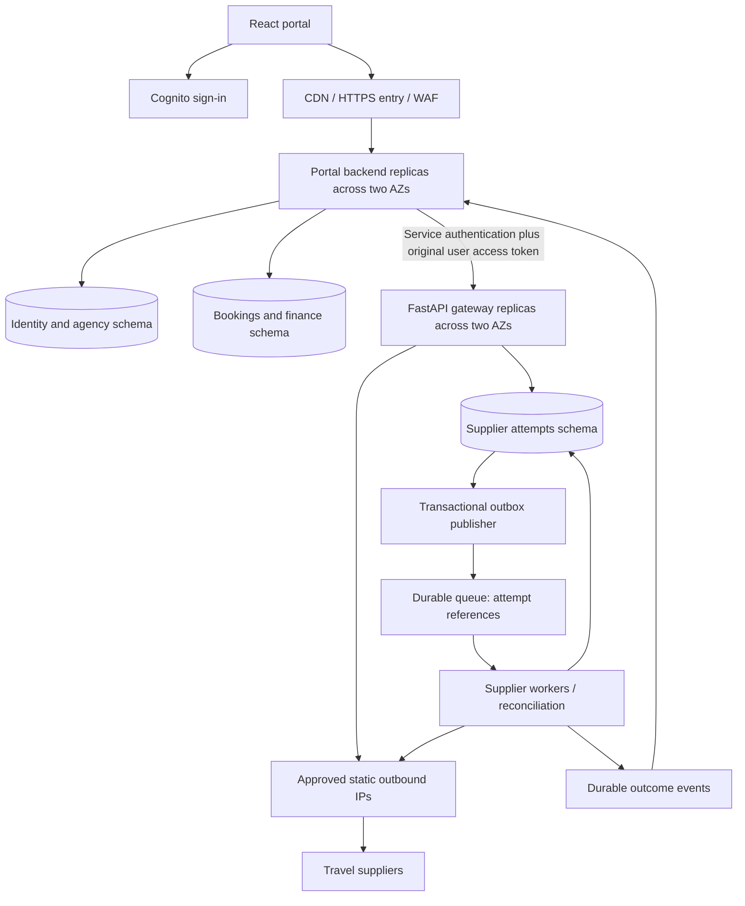
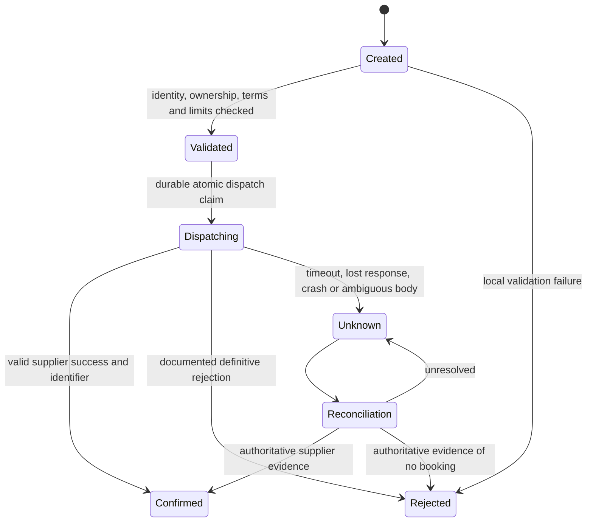

# Travelian production architecture and migration specification

Date: 2026-10-23 (Asia/Karachi). Status: **draft for review; no infrastructure or booking enablement approved**.

Scope: Travelian portal frontend/backend and the FastAPI supplier gateway. This is Step 1: design only. It introduces no runtime behavior, cloud resources, credentials, public routes, or live supplier calls.

## 1. Decisions and boundaries

### Immediate delivery scope — incremental rollout

User direction after the feature review: deliver working data loading and one complete booking integration first, then enhance step by step. The first supplier is interpreted as the existing Dhillu & Sahi Group Ticketing integration; this is not a one-passenger restriction. PHPTRAVELS breadth and the full HA target are roadmap context, not prerequisites for implementing every initial feature.

The first delivery slice is:

1. Trace portal-to-gateway inventory loading and mapping using the actual versioned routes; handle loading, empty, error and partial-supplier outcomes truthfully. Preserve the combined public inventory contract and original PNR. Keep the inventory route separate from filtered search.
2. Connect selection, one-way search and availability to the same supplier record without fabricated offers, browser-generated supplier PNRs or silently changed request values. Display current supplier data; do not claim that availability locks seats or fares.
3. Complete minimum trusted caller/agency/agent identity and booking ownership. Existing booking access remains fail-closed until these are established; a full agency distribution or credit platform is not required for the narrow pilot.
4. Implement one durable, duplicate-protected booking flow and booking-details/status retrieval with explicit Unknown outcomes and a supplier-supported reconciliation procedure. Confirm pricing, passenger, timestamp and financial obligations before enabling it. No automatic booking retries.
5. Validate the complete flow with mocked supplier transport and reviewed acceptance criteria. A live booking requires a separate concrete payload, financial approval and explicit authorization. Existing successful live reads do not authorize creation.

Later increments add the next approved supplier/product and then business-selected pricing, finance, documents, reporting and distribution capabilities. Implement a financial control immediately if the initial booking flow requires it; do not defer controls that protect real money or ownership. Do not postpone the first narrow integration to build every competitor feature or migrate infrastructure. Separately approve and schedule multi-AZ hosting, database sizing, public routing and other production changes. Until that infrastructure is deployed and tested, do not claim the current single-server setup is highly available.

Preserve the existing production service and supplier-allowlisted static outbound IP `52.76.26.224`. This delivery direction changes priorities, not supplier contracts, approval boundaries or security requirements. The business channel and authoritative identity/agent mapping still require confirmation; do not infer them from the supplier choice.

- Reuse Cognito for identity, React for the portal, the Node.js portal backend, and FastAPI supplier adapters. No wholesale language rewrite is justified.
- Put authoritative membership, permissions, booking ownership, and financial records on the server. Browser state is presentation data only.
- Keep Live Ticketing, Group Ticketing, and Hotels as distinct API domains. Dhillu & Sahi remains exclusively Group Ticketing under its existing vendor boundary.
- Keep the current Lightsail instance and static public outbound IP **52.76.26.224** intact during migration. Supplier allowlisting is a release gate.
- Proposed target: two Availability Zones in Singapore, redundant application services, managed transactional storage, durable workers, and controlled static outbound addresses.
- Retain working DynamoDB content functionality initially. Move transaction-critical data through a reviewed migration, not a simultaneous rewrite of every feature.
- Keep booking creation/details fail-closed until identity, ownership, supplier contracts, and booking reliability acceptance gates pass.
- Public `/v2` routing, existing DNS, reverse proxies, and unrelated production services remain unchanged until a separately approved cutover.
- Budget, capacity, business permissions, and supplier-dependent behavior below remain review decisions. This document does not authorize procurement or deployment.

### Product scope review

The [PHPTRAVELS feature benchmark and Travelian gap review](product-feature-review.md) expands Step 1 with proposed B2B/B2C product priorities. Pricing, finance, documents, after-sales, reporting and content remain explicit portal modules. Competitor advertisements are reference material, not verified capabilities, approved Travelian requirements or supplier contracts. Security Phase 1 stays blocked until trusted identity and ownership are resolved. Approve the launch channel, payment model and feature priorities before freezing the release backlog.

## 2. Evidence and current state

Source snapshot: gateway HEAD `96abdb9` plus pending local Phase 1 changes; portal HEAD `df33818`. These are local source snapshots, not verified deployed release identities. The user reports healthy production deployment and successful inventory/search/availability. Historical deployment-audit observations about missing configuration and disabled services must not be treated as current production state.

| Evidence | Observed implementation | Architectural consequence |
| --- | --- | --- |
| Gateway `app/main.py`, `app/core/config.py` | FastAPI; environment/optional SSM settings; startup readiness | Preserve supplier gateway and separate health from supplier success |
| Gateway `app/core/booking_security.py`, `app/api/routes/group_ticketing.py` | Pending local deny dependency returns 503 on POST booking creation/details | Protection exists locally; deployment of this change has not been verified |
| Gateway `AGENTS.md`, Dhillu & Sahi `auth.py` | User-supplied login, inventory, availability, booking and details paths; creation has no automatic retry | Do not change supplier contracts or retry an unknown creation |
| Portal `src/lib/cognito-auth.ts`, `src/lib/auth-session.ts` | Cognito password sign-in and hosted code/PKCE flow; token/session cache in localStorage | Reuse the identity provider; backend must independently verify tokens |
| Portal `src/lib/role-mapping.ts`, `src/contexts/RoleContext.tsx` | Browser group/role state plus email/local-storage fallbacks | Not an authoritative permission or agency source |
| Portal `src/data/models.ts`, `src/contexts/AdminStore.tsx` | User/agency relationships declared; user and agency edits are React state updates | Build persistent subject-to-agency membership |
| Portal `aws/flight-api/src/auth.mjs` | Shared API-key mode; defaults to off; no Cognito JWT verification in this handler | Existing service-key pattern does not establish end-user identity |
| Portal `src/lib/booking-api.ts` | Booking-content requests do not attach Cognito tokens | Update request authentication before integrating protected APIs |
| Portal `aws/flight-api/src/services/content.mjs` | DynamoDB CONTENT_TABLE; BOOKING and CUSTOMER partitions; booking writes merge input, no caller ownership comparison | Existing content records are not trustworthy authorization records |
| Portal `aws/flight-api/src/providers/dhilluandsahi.mjs` | Shared supplier agent fallback; caller agent overrides; direct booking path | Secure/retire bypass paths before enabling gateway bookings |
| Gateway `.github/workflows/deploy-production.yml`, `deploy/` | Tested artifact deployment over SSH to Lightsail, health verification and rollback | Retain until replacement deployment and recovery are proven |

No environment values, secrets, deployed Cognito configuration, upstream authorizers, or live database records were inspected for this specification. Repository absence does not prove absence of external infrastructure.

## 3. Proposed service boundaries

The database boxes represent logical schemas with distinct owners; initially they may share one managed PostgreSQL deployment. This has a shared failure/capacity domain, mitigated by Multi-AZ failover and capacity testing. Separate databases are a later measured decision.

| Boundary | Owns | Must not do |
| --- | --- | --- |
| Portal identity module | Verified subject, memberships, agency status, permissions | Trust browser roles, email naming conventions, or requested agency IDs |
| Portal commerce module | Customer-facing booking, accepted terms/quote, ownership, wallet/payment ledger | Treat supplier `available=true` as payment or booking authorization |
| Gateway API | Supplier registry, normalization, availability, validated dispatch requests | Accept arbitrary supplier credentials/agent IDs from users |
| Gateway worker | Durable supplier attempts, one-time dispatch claim, supplier outcomes, reconciliation | Re-send a possibly committed booking on message redelivery |
| Content modules | Existing packages, editorial content and assets | Act as an unvalidated source of identity or financial ownership |

Each service receives database permissions for its own schema only. Cross-service operations use authenticated APIs/events. No shared-table writes or distributed database transaction across a supplier call.

## 4. Identity and authorization design

Proposed flow:

1. Portal obtains an access token through existing Cognito sign-in. Cognito issuer and allowed app clients are approved configuration, not values taken from the request.
2. Portal backend verifies signature, allowed algorithm, issuer, expiration, `token_use=access`, and client ID using the issuer's JWKS. Define bounded JWKS caching, key rotation, clock skew, and revocation/session lifetime behavior.
3. Resolve `(issuer, sub)` to an active user and active agency membership. Agency selection is accepted only if the subject has that membership. No match means deny.
4. Authorize the specific operation. Cognito groups may contribute coarse roles only after verification and approval of who manages those groups; membership/status remains authoritative server data.
5. Portal calls the private gateway using dedicated service authentication and forwards the original access token. A proposed rotating, scoped server-only service credential follows the existing API-key pattern; provision it only after secret-management approval. It is not a user credential or a replacement for user verification.
6. Gateway independently verifies the token and resolves membership/permission through an authenticated portal authorization API. Fail closed if resolution is unavailable. Do not trust `X-Role`, `X-Agency-ID`, or unsigned caller context.
7. Resolve supplier account/agent through an approved server-side mapping. An explicit submitted agent ID that conflicts with the derived value is rejected; the canonical request eventually omits it.
8. Before supplier dispatch, recheck relevant authorization/status. On details access, prove booking ownership before fetching supplier data. Unknown ownership is denied.

Keep the gateway unreachable from browsers in the proposed target. Service authentication establishes the backend caller; the user token and membership checks establish the acting user. Network origin, CORS, and possession of a shared key do not prove agency ownership.

Browser token-storage hardening is a separate work item: localStorage exposes tokens to script execution. Evaluate a backend-managed Secure/HttpOnly session with CSRF controls versus the current SPA token model. Do not silently change login/session behavior during the first authorization implementation.

### Proposed least-privilege matrix — business approval required

| Actor | Create booking | View details | Manage membership / supplier mapping | Issue, cancel, refund |
| --- | --- | --- | --- | --- |
| Anonymous / invalid identity | Deny | Deny | Deny | Deny |
| B2C customer | Own customer context, only after B2C product/financial policy approval | Own verified customer booking | Deny | Deny by default; separate approved policy |
| Agency staff | Active membership plus explicit create permission | Own agency with view permission | Deny | Deny unless separately granted |
| Agency owner | Same agency-scoped checks as staff | Own agency | Approved staff-management scope only; no supplier mapping by default | Separate grants |
| Platform staff/admin | Explicit support/booking grants and recorded scope | Explicit approved scope with audit trail | Separate administrative grants | Separate financial/ticketing grants |
| QA / internal support | No implicit production booking grant | Explicit support scope only | Deny by default | Deny |
| Service identity alone | Deny user booking creation | Deny user details | Deny | Deny |

Agency hierarchy does not automatically grant parent access to child agencies. Define and test delegation explicitly. Supplier credentials and platform-admin labels do not imply access to every tenant.

## 5. Proposed authoritative data model

Logical entities below are design proposals, not existing tables or migrations. Use opaque IDs and server-derived ownership. Maintain foreign keys, tenant-scoped indexes, appropriate unique constraints, and audited administrative changes.

| Entity / owner | Essential data and invariant |
| --- | --- |
| User / portal identity | Internal user ID; unique issuer + Cognito sub; active status; no email-based authorization |
| Agency / portal identity | Agency ID, status, optional parent relationship; approval/suspension history |
| Agency membership / portal identity | User, agency, role, explicit grants, status, validity/version; unique membership |
| Customer account / portal identity | Verified user-to-customer relationship; distinguish a passenger/contact profile from an authenticated account |
| Supplier account mapping / portal identity | Agency, product, supplier, credential-reference ID, approved supplier-agent ID, status/version; never store secret plaintext in ordinary records |
| Booking / portal commerce | Portal booking ID, owner agency or customer, creator subject, product, accepted quote/terms reference, financial state, gateway attempt reference |
| Quote/acceptance / portal commerce | Amount/currency in exact minor units or fixed decimal, passenger counts, expiry and supplier references where documented; server-owned acceptance history |
| Supplier attempt / gateway | Attempt ID, portal booking reference, owner context, supplier account, state, request fingerprint, dispatch timestamps, supplier booking ID if known |
| Idempotency record / gateway | Unique authenticated tenant + operation + key; bound request fingerprint and attempt; no sensitive payload in key |
| Outbox / each producing service | Event ID, aggregate/version, minimal payload reference, publish status; written atomically with local business state |
| Processed event / consuming service | Unique event ID prevents repeated outcome application |
| Wallet/payment ledger / portal commerce | Exact amount/currency, immutable entry, external reference, authorization/reservation state; balanced entries and concurrency controls where wallet policy applies |
| Audit event / each service | Subject/service, tenant, action, object, decision, correlation ID, time; exclude tokens, full PNRs and passenger bodies |

Supplier booking IDs must be scoped by supplier/account; do not assume global uniqueness. Enforce ownership on queries and writes. PostgreSQL row-level security can provide defense in depth if transaction-scoped tenant context and connection-pool behavior are tested; it does not replace service checks.

Do not import localStorage roles, agency links, generated PNRs, payment flags, or arbitrary content fields as verified ownership. Existing bookings require a reviewed ownership backfill; ambiguous records remain inaccessible pending reconciliation.

## 6. API contracts and compatibility

All contracts in this section are proposed portal/gateway contracts. They do not add supplier endpoints or fields. Freeze exact request/response schemas in OpenAPI before implementation.

| Operation | Current state | Proposed behavior |
| --- | --- | --- |
| Group inventory / search | Versioned GET inventory and separate POST filtered search | Preserve combined Travelian group response and one-way filters; supplier failures remain in logs |
| Availability | Versioned POST; supplier PNR passed unchanged | Preserve mapping; result is an observation, not a reservation or price lock |
| Booking creation | POST `/v1/group-ticketing/bookings`; local 503 guard | Authorized, idempotent admission creates durable attempt; proposed 202 returns portal/attempt reference and status URL |
| Booking status | No persistent gateway attempt resource | New authenticated resource by opaque attempt ID; tenant authorization; never interpret timeout as safe-to-retry |
| Booking details | Existing POST `/v1/group-ticketing/booking-details`; local 503 guard | Ownership check before supplier read; retain protection during deprecation |
| GET booking details | `/v1/group-ticketing/bookings/{booking_id}` is absent | Proposed new route using defined portal identity/ID semantics; do not confuse portal IDs with raw supplier IDs |
| Internal authorization | Absent | Authenticated portal endpoint resolves subject + operation + object to membership and ownership decision; never accept unverified agency context |

Proposed error semantics: 401 missing/invalid identity; 403 authenticated but not permitted; 404 for inaccessible/missing booking according to an approved anti-enumeration policy; 409 conflicting idempotency payload; 422 invalid request; 503 missing/unavailable authorization configuration. Do not leak raw supplier responses, tokens, passenger data, or existence across agencies.

A proposed asynchronous booking API and removal of caller-controlled agent identity are breaking changes. Introduce an explicit contract version/client migration; retain existing 503 guards until approved callers migrate. Do not silently replace the current response shape or enable an old endpoint as a compatibility bypass.

Supplier PNRs stay unchanged end-to-end, including punctuation; do not generate a substitute or use a PNR as proof of ownership. Supplier request fields remain exactly those in the approved contract. Quote, idempotency and ownership references are gateway-side unless the supplier explicitly supports them.

## 7. Booking lifecycle, consistency and money

- Persist booking intent/idempotency and outbox message in one local transaction. The queue contains an attempt reference, not passport/PNR bodies. Publisher and consumer tolerate duplicate events.
- A unique constraint and atomic state transition allow exactly one worker to claim creation dispatch for an attempt. Verify the bound fingerprint on repeated keys; return the original attempt for identical requests.
- Write `Dispatching` before the supplier POST. A worker crash around that boundary is conservative: expired dispatch work becomes Unknown, never automatically eligible for another creation.
- Do not hold a database transaction open during network calls. Do not automatically retry creation at the HTTP client, proxy, queue consumer, or orchestration layer.
- Unknown includes possible supplier success followed by invalid JSON, malformed booking ID, transport loss, or failure to persist the response. A 5xx response is not inherently proof that no booking exists.
- Reconciliation must use a documented lookup/client reference that works when the booking ID is unknown. The current details endpoint requires a known booking ID and cannot solve every lost-response case. Where no lookup exists, use an authorized manual supplier process and block repeat creation.
- The strongest achievable guarantee without supplier idempotency/lookup is prevention of automatic redispatch plus explicit unknown outcomes, not universal exactly-once creation. Different idempotency keys can still represent the same itinerary; agree on a reviewed duplicate-warning policy rather than assuming each is a distinct purchase.
- Only a confirmed response with a contract-valid identifier confirms creation. Positive integer validation is proposed pending supplier ID confirmation; reject booleans as identifiers.
- Separate supplier booking state, payment state and ticket issuance state. A created booking is not proof of payment or ticket issuance.
- For wallet bookings, proposed atomic funds reservation and append-only ledger prevent double spending. Unknown outcomes retain the reservation pending reconciliation; no automatic release/refund solely because of timeout. Accounting, settlement and release policy require business approval.
- Validate fare/seat acceptance as close to dispatch as documented supplier behavior allows. Availability cannot eliminate fare/seat races. Do not invent supplier reservations, locks, payment APIs or compensation endpoints.

## 8. Static outbound IPs and supplier allowlisting — mandatory

| Stage | Egress design | Gate |
| --- | --- | --- |
| Current production | Preserve Lightsail `52.76.26.224` | No replacement, detachment, DNS/proxy/firewall change in design work |
| Staging | Dedicated fixed staging egress; mocks by default | Supplier approval before any separately authorized live read; creation remains prohibited |
| Proposed two-AZ production | Private gateway/worker subnets; zonal public NAT gateways with fixed Elastic IPs; same-AZ routing | Every actual outbound address approved by every applicable supplier |
| Recovery region, if commissioned | Separately reserved/allowlisted outbound addresses | Recovery rehearsal and supplier approval before activation |

Application replicas, rescheduling, and deployments must not select arbitrary public addresses. Every supplier client, worker and reconciliation path must use approved egress. Constrain service permissions/network paths so callers cannot bypass it. Test observed source IP from each zone and each execution role/path before cutover, then monitor configuration drift.

Supplier IP allowlisting is outbound identity at the network boundary. The portal hostname and inbound load-balancer IP are not substitutes. Static IPs do not replace authentication.

The existing Lightsail IP is not assumed transferable to VPC NAT or a different region. Obtain new allowlisting before moving supplier traffic. Keeping Lightsail as the sole egress relay can be a temporary bridge, but remains a single point of failure and must not be described as the HA end state.

If a supplier permits only one IP, document its failure-domain limitation and obtain a separately reviewed supported failover design or accept reduced supplier availability. Do not promise two-AZ supplier availability on a one-relay design.

## 9. Hosting, capacity and failure isolation

Proposed baseline is ECS Fargate for portal backend, gateway and workers, with managed HTTPS load balancing, private gateway access, and at least two replicas across two AZs for each always-on API service. Configure actual AZ placement/rebalancing and verify it. Keep the React frontend on CDN/static delivery; no frontend rewrite is required.

Use RDS PostgreSQL Multi-AZ as the initial transactional database candidate. Standard relational constraints and transactional booking/ledger work motivate SQL. Aurora PostgreSQL is the alternative to price/test if variable compute, reader scaling or recovery measurements justify it. Retain existing DynamoDB content during phased migration; choose a single authoritative owner per entity and avoid uncontrolled dual writes.

Proposed queue workers scale separately from search APIs. Set supplier-wide/account-wide request and creation concurrency budgets across all replicas using durable coordination. Per-request semaphores alone are insufficient. Supplier quotas and target traffic must be measured/confirmed before setting limits. Protect supplier connections with bounded pools, deadlines and circuit breakers; retries are operation-specific and never blanket-enabled for creation.

Capacity plan inputs: observed peak search QPS, supplier calls/search, peak booking attempts/minute, supplier p95 latency, limits/account, payload sizes, database connections, and retained data growth. Establish current baseline and staging load tests; do not claim a supported concurrency figure before measuring it. Ensure one surviving AZ can carry the agreed peak or explicitly define degraded admission control.

Cache inventory/search only where contract and privacy allow, with visible age, bounded TTL and tenant/account-safe keys. Never authorize booking from stale cache. Add a managed cache only if measurements justify another dependency; keep idempotency and financial truth durable.

## 10. Availability, recovery and operations

Provisional target for review: 99.95% monthly availability for Travelian-controlled authenticated API operations, excluding expected client validation/authentication errors from the error numerator. Measure external dependencies and user-visible booking success separately; do not remove supplier failures from the customer-experience report. A durable 202 receipt is admission, not a confirmed booking. Track completion latency and Unknown age alongside admission availability.

| Failure | Proposed response | Acceptance evidence |
| --- | --- | --- |
| One API task fails | Healthy replicas handle traffic; scheduler replaces task | Kill/restart test; no unauthorized responses or repeated dispatch |
| One AZ fails | Remaining capacity, database failover and approved egress serve requests | AZ failure exercise, observed source IPs and measured recovery |
| Database fails over | Reconnect with bounded retry for safe operations; read durable attempt before further processing | Failover test with in-flight booking attempts |
| Supplier fails | Isolate supplier; preserve successful inventory; stop unsafe creation retries | Mocked timeout/5xx and partial-result tests |
| Worker/queue message repeats | Atomic attempt state prevents redispatch | Redelivery, crash-before/after-dispatch tests |
| Region lost | Initially a documented backup/restore recovery procedure | Restore drill; region-level RTO/RPO explicitly approved |

Provisional drill goals, not guarantees: service/AZ recovery within 15 minutes; backup-based regional recovery within 24 hours and no more than 5 minutes of database backup data loss where the selected backup design supports it. Regional loss can also destroy knowledge of supplier dispatch; reconcile restored in-flight attempts before reopening booking creation. Approve tighter regional targets and associated cost separately. Multi-AZ is not regional disaster recovery.

Operational baseline: encrypted backups and point-in-time recovery, restore rehearsals, asset/document recovery, off-region backup strategy subject to data-residency approval, secret rotation, least-privilege workload roles, private database, TLS, WAF/rate limits, payload limits, and dependency/image scanning.

Collect correlation/attempt IDs, authorization decisions, per-supplier success/failure/timeout, API latency/errors, database connections, queue oldest age, outbox lag, Unknown booking age, financial reconciliation exceptions and egress configuration changes. Alert to a named owner with a runbook. Redact credentials, access/refresh tokens, passenger documents and raw supplier payloads. Use restricted audit storage; normal logs must not contain full PNRs or passport numbers. Define retention/deletion with business/legal owners before production data migration.

`/health` checks process responsiveness. `/ready` should reflect ability to serve the service's essential local dependencies without calling suppliers on every probe. Do not make every supplier failure remove otherwise useful replicas from the load balancer.

## 11. Deployment and migration sequence

| Phase | Deliverable | Release gate |
| --- | --- | --- |
| 1: specification (this change) | Architecture, product feature benchmark/priorities, proposed entities/policies/contracts, IP strategy and decision register | Review design and launch feature scope; no runtime release |
| 2: trusted identity | Verified Cognito, persistent memberships/status, scoped permissions and service authentication | Negative auth/impersonation/cross-agency tests; no local-storage authority |
| 3: ownership integration | Protected booking/customer ownership, approved supplier-agent mapping, secured legacy routes | Unknown ownership denies access; both old and new details paths protected |
| 4: durable booking workflow | Attempts/idempotency/outbox, reconciliation, confirmed quote/financial rules | Failure-path and concurrency suite; authoritative supplier contract complete |
| 5: redundant staging | Two-AZ services, managed DB/queue, fixed egress, monitoring/backups and CI/CD | Load, failover, source-IP and restore tests; cost review |
| 6: controlled production migration | Verified imports, client contract migration, allowlisting, approved routing and cutover | Explicit approval; canary and rollback evidence; one creation path |
| 7: operations and scale | Capacity tuning, recovery drills, access/retention review, optional regional standby | Measured SLOs and recovery targets |

Phases 2–4 may be built locally before infrastructure is commissioned. Staging uses synthetic users, agencies, financial records and mocked suppliers. No real booking is part of this plan's validation authority.

Migration rules:

- Inventory existing DynamoDB record shapes/counts and legacy ownership evidence through separately authorized reads. Import to staging and verify counts, relationships and financial totals. Unverifiable ownership or balances require manual review.
- Use one writer per entity during transition. Prefer a bounded transactional cutover window over untracked dual writes. If continuous capture is required, design durable change capture and reconciliation explicitly.
- Shadow only safe reads where suppliers allow the traffic. Never mirror booking creation, payment, ticketing or cancellation.
- Secure or disable the Node supplier-booking bypass before gateway enablement. Verify every externally reachable legacy route, not only frontend navigation.
- Use backward-compatible schema expansion before client changes. Deploy portal/gateway contracts together in staging; retain protected compatibility paths until callers migrate.
- Build immutable tested artifacts, pin runtime dependencies and images, record source revision, scan artifacts, and promote the same artifact to production. Separate migration execution from application startup; serialize it and use least-privilege credentials.
- Require healthy readiness, graceful draining, capacity for rolling deployments, a deployment circuit breaker, and monitored canary promotion. Long-running booking attempts remain durable across release changes.
- Database migrations use expand/contract and application rollback compatibility. Never restore an old database snapshot as routine code rollback: it may lose booking/financial writes.
- Traffic rollback is safe for reads after compatibility checks. Once creation moves, route subsequent work to the system that owns each durable attempt; a legacy release must not create a duplicate or interpret new states incorrectly.
- Keep the current server, IP and unrelated website intact until decommission is explicitly approved. Public `/v2` stays unchanged throughout design and staging.

## 12. Required tests before booking enablement

- Authentication: absent/invalid/expired token, wrong issuer/client/token use, forged claims, key rotation, service credential absent/invalid, authorization-service outage.
- Authorization: disabled user/agency, no membership, impersonated supplier agent, B2C versus B2B ownership, cross-agency reads/writes, parent/sub-agency delegation, explicit support permissions, unknown legacy ownership.
- Supplier contract: PNR unchanged, passenger counts/arrays/timestamps, documented rejections, invalid JSON, invalid IDs including bool/zero, malformed success, login failure, supplier partial acceptance if supported. No invented success fixtures presented as verified supplier behavior.
- Reliability: simultaneous identical requests, same key/different payload, lost client response, queue duplication, worker crash around dispatch, lost supplier response, DB failover after supplier creation, outbox replay, status-event duplication and reconciliation.
- Financial: concurrent spends, currency precision, insufficient funds, repeated callbacks, timeout reservations, authorized releases/refunds and settlement mismatches using mocked providers.
- Platform: peak-load profile, task/AZ loss, all-zone outbound IP checks, backup restore, schema/app rollback, legacy-route bypass checks, redaction and sensitive error-response checks.

Live read-only probes and a first supplier booking require separate concrete approval, an exact payload, financial acceptance and a reconciliation owner. Health checks are not evidence of booking correctness.

## 13. Cost and complexity controls

No monthly price or instance size is committed here. Build an ap-southeast-1 estimate before resource approval with actual load assumptions and official current pricing.

| Option | Included | Explicit limitation |
| --- | --- | --- |
| Foundation on existing hosting | Secure identity/ownership, durable workflow design/implementation, tests | Existing server/egress remains a single point of failure; not the HA target |
| Recommended production baseline | Two-AZ APIs, Multi-AZ DB, queue/workers, fixed zonal egress, load balancing, monitoring and backups | Single-region operation; supplier IP policy may still constrain availability |
| Enhanced regional recovery | Baseline plus approved standby/recovery automation, replicated data/backups and preapproved regional egress | Additional recurring cost, data-residency and duplicate-dispatch recovery complexity |

Estimate application/worker baseline and surge, database/backup storage, NAT hours/processing/public IPs, load balancer, WAF, transfer, queue, secret access, logs/metrics, CDN/assets, CI artifact storage and staging separately. Exclude supplier/payment fees from infrastructure totals and show them separately if known. Use budgets, retention limits and scaling ceilings with alerts rather than unbounded autoscaling.

No Kubernetes, service mesh, per-module microservice split, multi-region active-active booking, cache cluster or full content database migration is required for the baseline. Managed container hosting and a relational transaction store are proposed because the expanded task now requires redundant services and durable commerce; they are not changes to the existing Lightsail deployment.

## 14. Decision register and next implementation package

| ID | Decision / missing evidence | Proposed owner | Blocks |
| --- | --- | --- | --- |
| D1 | Approve Cognito issuer/client allowlist and group administration; choose token/session and revocation policy | Platform/security owner | Trusted identity |
| D2 | Approve canonical membership/agency status source and administrator provisioning process | Business/security owner | Agency authorization |
| D3 | Approve role matrix, sub-agency delegation and B2C booking policy | Business owner | Booking permissions |
| D4 | Confirm whether one supplier account serves many agencies; verify agent meaning and mapping authority | Supplier/business owner | Safe supplier dispatch |
| D5 | Obtain authoritative booking fields, timestamp meaning, price/seat behavior, rejection/ID format, financial obligation and partial-acceptance rules | Supplier/business owner | Live booking |
| D6 | Confirm supplier idempotency/unknown-booking lookup or manual reconciliation procedure | Supplier/operations owner | Safe unknown-outcome handling |
| D7 | Confirm allowed number of source IPs for every supplier and approval process for staging/production/recovery IPs | Supplier/network owner | HA egress cutover |
| D8 | Validate and approve legacy ownership/financial-data migration and retention | Business/data owner | Existing booking access and balances |
| D9 | Approve budget, traffic/load profile, provisional SLO/RTO/RPO, residency and support coverage | Business/platform owner | Infrastructure sizing and provisioning |
| D10 | Approve API version/ID semantics, asynchronous client experience and legacy route retirement | Product/API owner | Client cutover |
| D11 | Approve launch channel/products, pricing/commission, prepaid/credit, documents, reporting and after-sales scope from the feature review | Business/product/finance owners | First commercial release backlog |

Next local implementation package after design review: publish identity/membership and ownership OpenAPI/data-model proposals, obtain D1–D4 decisions, then replace the deny guard with verified identity and scoped authorization under mocks. Do not invent identities, supplier-agent mappings or production credentials to unblock development. Booking remains disabled while contracts and reliability are incomplete.

Step 1 completion means this reviewable design exists and source/reference checks pass. It does not mean the architecture has been deployed, availability targets achieved, or Phase 1 booking authorization unblocked.

## 15. References

Repository links resolve within this gateway checkout; portal paths in section 2 refer to the sibling Travelian portal repository.

- [Gateway guidance and confirmed supplier contracts](../../AGENTS.md)
- [Gateway request routes](../../app/api/routes/group_ticketing.py)
- [Pending local booking guard](../../app/core/booking_security.py)
- [Historical production deployment audit](../../deploy/PRODUCTION_AUDIT.md) — historical observations only
- [Cognito token verification](https://docs.aws.amazon.com/cognito/latest/developerguide/amazon-cognito-user-pools-using-tokens-verifying-a-jwt.html) — verification is more than decoding browser claims
- [ECS Availability Zone balancing](https://docs.aws.amazon.com/AmazonECS/latest/developerguide/service-rebalancing.html) — supports redundant service placement; application sizing remains our responsibility
- [ECS load balancing](https://docs.aws.amazon.com/AmazonECS/latest/developerguide/service-load-balancing.html)
- [RDS Multi-AZ failover](https://docs.aws.amazon.com/AmazonRDS/latest/UserGuide/Concepts.MultiAZ.Failover.html) — managed failover, not continuous availability for every fault
- [NAT resilience and addressing](https://docs.aws.amazon.com/vpc/latest/userguide/nat-gateway-basics.html) — same-AZ egress planning and static address approval
- [SQS delivery behavior](https://aws.amazon.com/sqs/faqs/) — consumers must tolerate repeated work; queues do not guarantee exactly-once supplier creation
